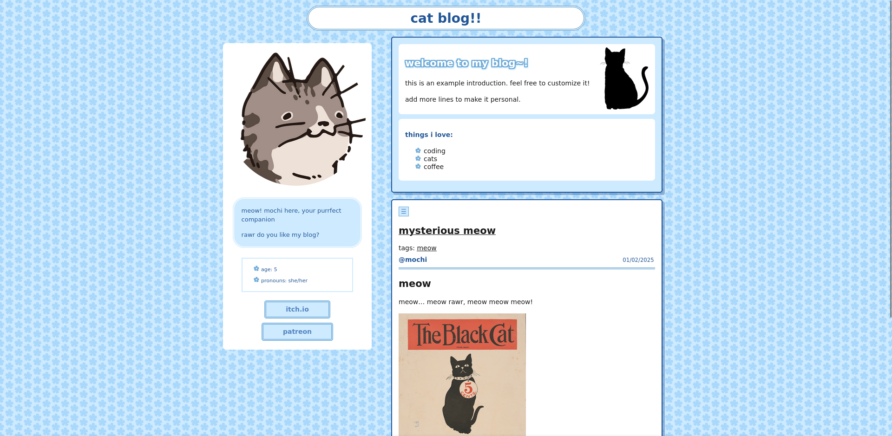

# neopost
*neopost* is a minimalist, customizable theme for personal blogs, inspired by the aesthetics of neocities. it allows for multilingual, flexible content management and easy customization of styles through simple configuration.

this example site is available at [neopost.neocities.org](https://neopost.neocities.org).

## installation & quickstart
```bash
hugo new site my-site
cd my-site
git clone "https://github.com/salatine/neopost.git" themes/neopost

# copy over the hugo configuration file
cp example/hugo-en.toml hugo.toml

# create the post (edit it later yourself ok)
hugo new content/posts/new-post.md

# run the server and see it!
hugo serve

```

## configuration

`example` folder has both `hugo-en` and `hugo-en-jp` files 
in both `toml` and `yaml` formats. 
If you aren't familiar with either formats, prefer the `toml` format.

`hugo-en` is a single-language quickstart, 
and most likely you'll want to use this one.
`hugo-en-jp` shows how you can set up a two-language setting.

Choose one and copy it over to the root of your project, 
and name it as `hugo.toml` OR `hugo.yaml`.

### Parameters

The following parameters can be configured under `[params]` (TOML) or `params:` (YAML).

You can also add your own custom themes at `/data/custom_themes.yaml` and add its name in the `theme` parameter. if a name of a theme by neopost is conflicted with a custom theme, the themes by neopost are prioritized. all of this is showcased in the example site!


| Parameter | Type | Description |
|---|---|---|っと読む
| `theme` | String | Choose: `light-blue`, `dark-blue`, `light-green`, `light-yellow`, `light-pink`, `light-purple` |
| `favicon` | String | Path to the website's favicon. |
| `posts-per-page` | Integer | Number of posts displayed per page. Default: 5 |
| `toc-auto-numbering` | Boolean | Automatically number table-of-contents entries globally. |
| `dateformat` | String | The format of the time. [IMPORTANT: Please see the Golang docs on how to input the format properly.](https://pkg.go.dev/time#pkg-constants)

#### Sidebar

| Parameter | Type | Description |
|---|---|---|
| `sidebar.tags.enable` | Boolean | Enable or disable the tag list in the sidebar. |
| `sidebar.tags.limit` | Integer | Maximum number of tags displayed in the sidebar. Default 5 |
| `sidebar.tags.more-text` | String | Text displayed for the link to additional tags. |

#### Read More

| Parameter | Type | Description |
|---|---|---|
| `read-more.length-limit` | Integer | Character limit before the read-more button appears. |
| `read-more.text.more` | String | Text displayed when the content is collapsed. |
| `read-more.text.less` | String | Text displayed when the content is expanded. |

## Multilingual Configuration

When using two or more locales, you can set different values for each locale.
When you don't have it set in locale explicitly, the default params one will be used. 
example: Date format
```toml
[params]
  # uses this value when locale does not have set explicitly
  dateformat = '01/02/2006'

[languages.en.params]
  dateformat = '02/01/2006 15:04:05-0700'

[languages.jp.params]
  dateformat = '2006-01-02 15:04:05-0700'

```

## example site
it's *HIGHLY!* recommended to test the example provided with the theme, just to learn how to mess with it. you can do that by running (considering you already did the installation steps):
```bash
cp -r themes/neopost/example/. .
hugo serve
```

The example will provide an example how to arrange your blog posts in two languages. 
It's good to have images together with the post that is using it
and you'll be glad you did it!

note: images provided in this example site are mostly taken from the [library of congress](https://www.loc.gov/free-to-use/cats/).

## creating content

### posts
```
hugo new content/posts/new-post.md
```
this is most of your stuff, a post will appear at the main page and each one will have a page for itself. you can also attribute tags to your posts, which then can be filtered to easily find specific posts.
you can edit it at `content/posts/new-post.md`.


### sidebar
```
hugo new --kind sidebar sidebar
```
the sidebar from the main page, add a bio and little information about you!
you can edit it at the directory `content/sidebar/`, there are multiple markdown files to edit


### welcome header
```
hugo new --kind welcome-header welcome-header
```
this is above all the posts in the main page, you can give yourself a better introduction here, and say whatever you want.
you can edit it at `content/welcome-header/_index.md`.


### license
*neopost* is licensed under the [gpl-3.0 license](https://raw.githubusercontent.com/salatine/neopost/main/LICENSE).
